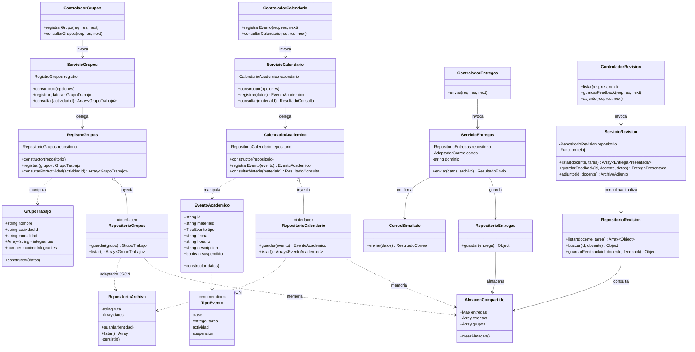

# Diagrama de Clases del Sistema

Este documento describe la arquitectura estructural de clases y componentes del sistema `ActivityClassroom`, integrando los cuatro módulos principales (HU-01 a HU-04), la capa de servicios, controladores HTTP y persistencia desacoplada.

---

## 1. Diagrama de Clases Unificado (Mermaid)

---

## 2. Descripción de Capas y Componentes

### 2.1. Capa de Dominio (Modelos Inmutables y Lógica de Negocio)
- **`EventoAcademico` (HU-01)**: Entidad congelada (`Object.freeze`) que representa clases, entregas de tareas, actividades o suspensiones con validación estricta de fechas ISO y tipo de evento.
- **`CalendarioAcademico` (HU-01)**: Colección y consultas especializadas por materia. Retorna estructuras defensivas e inmutables.
- **`GrupoTrabajo` (HU-02)**: Entidad congelada que encapsula la formación por afinidad o sorteo, validando no duplicidad de integrantes y cumplimiento de cupos máximos.
- **`RegistroGrupos` (HU-02)**: Gestiona el registro y consulta de grupos por actividad académica.

### 2.2. Capa de Aplicación / Servicios
- **`ServicioCalendario`**: Orquesta el registro y las consultas convirtiendo errores de dominio en `AppError(400)`.
- **`ServicioGrupos`**: Coordina validaciones y el registro de grupos por actividad con `AppError(400)`.
- **`ServicioEntregas` (HU-03)**: Valida archivos adjuntos (MIME, tamaño $\le$ 10 MB, extensiones `.pdf`, `.docx`, `.zip`), valida remitente institucional y coordina con `correoSimulado`.
- **`ServicioRevision` (HU-04)**: Filtra entregas por docente y tarea, extrae la más reciente por estudiante y actualiza el feedback estructurado en tres aspectos (`correcto`, `incorrecto`, `corregir`).

### 2.3. Capa de Controladores y Rutas HTTP
- **`ControladorCalendario`**: Expone `POST /api/calendario/eventos` y `GET /api/calendario?materia=:id`.
- **`ControladorGrupos`**: Expone `POST /api/grupos` y `GET /api/grupos?actividad=:id`.
- **`ControladorEntregas`**: Expone `POST /api/entregas` con carga de archivos multipart (`multer`).
- **`ControladorRevision`**: Expone `GET /api/revision/entregas`, `PUT /api/revision/entregas/:id/feedback` y `GET /api/revision/entregas/:id/adjunto`.

### 2.4. Capa de Persistencia
- **`AlmacenCompartido` (`datos-memoria.js`)**: Estructura en memoria centralizada que aloja `{ entregas, eventos, grupos }`, permitiendo que todos los módulos compartan el mismo estado volátil durante pruebas y demostraciones.
- **`RepositorioArchivo` (`repositorio-archivo.js`)**: Adaptador con persistencia atómica mediante archivo temporal y renombre seguro (`fs.renameSync`) para escribir en `eventos.json` y `grupos.json`.
- **Esquema Relacional (`backend/database/schema.sql`)**: Contrato relacional PostgreSQL para el despliegue en producción con integridad referencial.

---

## 3. Especificación en PlantUML

Para herramientas compatibles con PlantUML:

```plantuml
@startuml class
hide empty members

enum TipoEvento {
  clase
  entrega_tarea
  actividad
  suspension
}

class GrupoTrabajo <<inmutable>> {
  +nombre: string
  +actividadId: string
  +modalidad: "afinidad" | "sorteo"
  +integrantes: string[] {readOnly}
  +maximoIntegrantes: number | null
  +constructor(datos)
}

class EventoAcademico <<inmutable>> {
  +id: string
  +materiaId: string
  +tipo: TipoEvento
  +fecha: string
  +horario: string
  +descripcion: string
  +suspendido: boolean
  +constructor(datos)
}

class CalendarioAcademico {
  -repositorio: RepositorioCalendario
  +constructor(repositorio)
  +registrarEvento(evento)
  +consultarMateria(materiaId): ResultadoConsulta
}

class RegistroGrupos {
  -repositorio: RepositorioGrupos
  +constructor(repositorio)
  +registrar(grupo)
  +consultarPorActividad(actividadId): GrupoTrabajo[]
}

interface RepositorioCalendario <<interface>> {
  +guardar(evento: EventoAcademico)
  +listar(): EventoAcademico[]
}

interface RepositorioGrupos <<interface>> {
  +guardar(grupo: GrupoTrabajo)
  +listar(): GrupoTrabajo[]
}

class RepositorioCalendarioMemoria {
  -datos: AlmacenCompartido
  +guardar(evento)
  +listar(): EventoAcademico[]
}

class RepositorioCalendarioArchivo {
  -adaptador: RepositorioArchivo
  +guardar(evento)
  +listar(): EventoAcademico[]
}

class RepositorioGruposMemoria {
  -datos: AlmacenCompartido
  +guardar(grupo)
  +listar(): GrupoTrabajo[]
}

class RepositorioGruposArchivo {
  -adaptador: RepositorioArchivo
  +guardar(grupo)
  +listar(): GrupoTrabajo[]
}

class RepositorioArchivo {
  -ruta: string
  -datos: any[]
  +guardar(entidad)
  +listar(): any[]
  -persistir()
}

class AlmacenCompartido {
  +entregas: Map
  +eventos: EventoAcademico[]
  +grupos: GrupoTrabajo[]
}

class ServicioCalendario {
  -calendario: CalendarioAcademico
  +constructor(calendario)
  +registrar(datos): EventoAcademico
  +consultar(materiaId): ResultadoConsulta
}

class ControladorCalendario {
  +registrarEvento(req, res, next)
  +consultarCalendario(req, res, next)
}

class ServicioGrupos {
  -registro: RegistroGrupos
  +constructor(registro)
  +registrar(datos): GrupoTrabajo
  +consultar(actividadId): GrupoTrabajo[]
}

class ControladorGrupos {
  +registrarGrupo(req, res, next)
  +consultarGrupos(req, res, next)
}

class ServicioEntregas {
  -repositorio: RepositorioEntregas
  -correo: CorreoSimulado
  -dominio: string
  +enviar(datos, archivo): ResultadoEnvio
}

class ControladorEntregas {
  +enviar(req, res, next)
}

class ServicioRevision {
  -repositorio: RepositorioRevision
  -reloj: Function
  +listar(docente, tarea): EntregaPresentada[]
  +guardarFeedback(id, docente, datos): EntregaPresentada
  +adjunto(id, docente): ArchivoAdjunto
}

class ControladorRevision {
  +listar(req, res, next)
  +guardarFeedback(req, res, next)
  +adjunto(req, res, next)
}

ControladorCalendario --> ServicioCalendario : usa
ServicioCalendario --> CalendarioAcademico : delega
CalendarioAcademico --> RepositorioCalendario : inyectado

ControladorGrupos --> ServicioGrupos : usa
ServicioGrupos --> RegistroGrupos : delega
RegistroGrupos --> RepositorioGrupos : inyectado

ControladorEntregas --> ServicioEntregas : usa
ControladorRevision --> ServicioRevision : usa

RepositorioCalendarioMemoria ..|> RepositorioCalendario
RepositorioCalendarioArchivo ..|> RepositorioCalendario
RepositorioGruposMemoria ..|> RepositorioGrupos
RepositorioGruposArchivo ..|> RepositorioGrupos

RepositorioCalendarioMemoria --> AlmacenCompartido : datos
RepositorioGruposMemoria --> AlmacenCompartido : datos

@enduml
```

