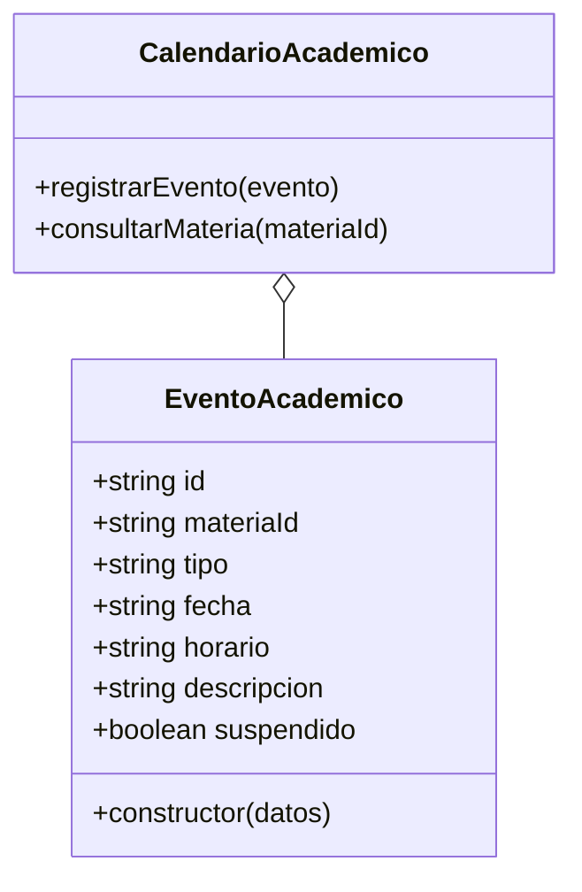

# Tarea 01: consultar el calendario académico

Historia: **HU-01 — Consulta del calendario académico**.

## Alcance del primer incremento

Crear las clases `EventoAcademico` y `CalendarioAcademico` para representar y
consultar los eventos de una materia:

- Identificador del evento e identificador de la materia.
- Tipo: clase, entrega de tarea, actividad o suspensión.
- Fecha, horario opcional y descripción.
- Indicador de suspensión para las clases canceladas.

`CalendarioAcademico` registra eventos en memoria. `consultarMateria(materiaId)`
devuelve `{mensaje, eventos}` con únicamente los eventos de la materia consultada;
si no existen eventos, `mensaje` contiene el aviso informativo y `eventos` es un
arreglo vacío. Los eventos y los resultados de las consultas son de solo lectura.

El registro de este incremento vive en memoria. Todavía no hay pantalla, base de
datos, catálogo de materias ni autenticación de estudiantes.

## Pruebas de aceptación del incremento a nivel de dominio

| Caso | Dado / cuando | Resultado esperado |
| --- | --- | --- |
| Registro de una clase | Crear un evento con materia, fecha, horario y descripción | Se consulta con sus datos |
| Entrega de tarea | Registrar un evento de tipo `entrega_tarea` | Se conserva el tipo y la fecha |
| Actividad académica | Registrar un evento de tipo `actividad` | Se conserva el tipo y la descripción |
| Suspensión | Registrar una clase suspendida | La consulta refleja `suspendido: true` |
| Filtro por materia | Consultar una materia con eventos de varias materias | Solo se devuelven los eventos de esa materia |
| Consulta vacía | Consultar una materia sin eventos | Se devuelve un mensaje informativo y un arreglo vacío |
| Datos incompletos | Omitir identificador, materia, tipo, fecha o descripción | Se rechaza el evento |
| Tipo inválido | Registrar un tipo distinto de los admitidos | Se rechaza el evento |
| Fecha inválida | Usar una fecha que no sea `AAAA-MM-DD` o que no exista | Se rechaza el evento |
| Horario inválido | Enviar un horario vacío o con espacios en los extremos | Se rechaza el evento |
| Evento establecido | Intentar cambiar los datos de un evento | El evento permanece sin cambios |
| Consulta estable | Intentar modificar el arreglo devuelto | La consulta permanece sin cambios |

## Diagrama UML del incremento

El constructor de `EventoAcademico` valida los datos y congela la instancia.
`CalendarioAcademico` mantiene los eventos en una colección privada, filtra por
materia y devuelve una copia congelada. La fecha se valida como una fecha real en
formato `AAAA-MM-DD`; el horario es opcional y, si se envía, debe ser una cadena
no vacía sin espacios en los extremos. El tipo se limita a `clase`,
`entrega_tarea`, `actividad` y `suspension`.

## Evidencia del ciclo TDD

Se ejecutó `node --test` en cada paso con Node.js 26.12.1. Se utilizan `node:test`
y `node:assert/strict`, módulos nativos, sin instalar paquetes.

| Ciclo | Rojo: prueba antes del código | Verde: implementación mínima | Commit en verde |
| --- | --- | --- | --- |
| Registro y consulta | `ERR_MODULE_NOT_FOUND`: todavía no existían las clases | Clases creadas; 4 pruebas de calendario pasan | `d218674` |
| Validación del registro | 10 pruebas nuevas fallan por falta de validaciones | Validaciones añadidas; 14 pruebas de calendario pasan | `bb65ad6` |
| Consulta estable | 4 pruebas nuevas fallan al intentar modificar eventos o resultados | Eventos y copias congelados; 18 pruebas de calendario pasan | `9971a52` |

Después se revisó el código para refactorizar: no hizo falta agregar más clases
ni extraer abstracciones.

## Checklist XP de esta tarea

- [x] Alcance, reglas y criterios del incremento identificados.
- [x] Diagrama UML elaborado.
- [ ] Tarjeta CRC: elaboración manual por el estudiante.
- [x] Casos de aceptación diseñados y expresados como pruebas de dominio.
- [x] Pruebas escritas y ejecutadas antes del código correspondiente.
- [x] Funcionalidad mínima implementada.
- [x] 18 pruebas de calendario y 39 pruebas del proyecto ejecutadas satisfactoriamente.
- [x] Necesidad de refactorización revisada.
- [x] Incremento contrastado con sus criterios.
- [ ] HU-01 completa, con integración con actividades, entregas y notificaciones.

## Siguientes tareas, una por ciclo TDD

| Tarea | Primera prueba propuesta |
| --- | --- |
| Consultar el calendario completo de una materia | Se obtienen todos sus eventos ordenados por fecha |
| Registrar cambios de horario | Una modificación reemplaza el horario anterior |
| Integrar entregas de tareas | Una entrega aparece en el calendario de la materia |
| Notificar suspensiones | Una suspensión registrada se refleja en la consulta |
| Persistir los eventos | Los eventos sobreviven al reinicio del proceso |

Las tareas siguientes están pendientes. Cada una empieza con una prueba que
falle; después se escribe el código mínimo y se ejecutan las pruebas. Las tarjetas
CRC se elaborarán manualmente a partir de las clases implementadas.
