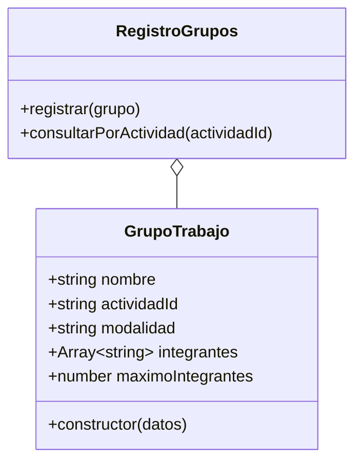

# Tarea 01: registrar un grupo de trabajo

Historia: **HU-02 — Formación y registro de grupos de trabajo**.

## Alcance del primer incremento

Crear una clase `GrupoTrabajo` que represente un grupo desde su registro inicial:

- Nombre del grupo e identificador de su actividad.
- Modalidad: afinidad o sorteo. El sorteo ya fue realizado fuera del sistema.
- Identificadores de los integrantes registrados manualmente.
- Tamaño máximo opcional, indicado por la actividad.

La clase debe rechazar integrantes duplicados y grupos que superen el máximo.
El grupo queda establecido al crearse: sus datos e integrantes son de solo
lectura. No se agrega un flujo para cambiar integrantes ni para aprobar grupos.

El registro de este incremento vive en memoria. Todavía no hay pantalla, base de
datos, catálogo de actividades ni validación de matrícula de los estudiantes.

## Pruebas de aceptación del incremento a nivel de dominio

| Caso | Dado / cuando | Resultado esperado |
| --- | --- | --- |
| Registro por afinidad | Crear un grupo con actividad e integrantes | Se pueden consultar sus datos e integrantes |
| Registro por sorteo | Registrar integrantes de un sorteo ya realizado | Se conserva la modalidad y la lista recibida |
| Integrante duplicado | Registrar dos veces el mismo identificador | Se rechaza el grupo |
| Máximo superado | Registrar tres integrantes con máximo dos | Se rechaza el grupo |
| Límite exacto | Registrar dos integrantes con máximo dos | Se acepta el grupo |
| Sin máximo | Registrar integrantes sin una restricción de tamaño | Se acepta el grupo |
| Datos incompletos | Registrar nombre, actividad o integrantes vacíos | Se rechaza el grupo |
| Modalidad inválida | Registrar una modalidad distinta de afinidad o sorteo | Se rechaza el grupo |
| Máximo inválido | Indicar un máximo que no sea un entero positivo | Se rechaza el grupo |
| Grupo establecido | Intentar cambiar los datos o integrantes después del registro | El grupo permanece sin cambios |

## Diagrama UML del incremento

El constructor valida los datos. Los atributos se consultan directamente y no
admiten reasignación. `Object.freeze` congela el grupo y una copia del arreglo de
integrantes, de modo que modificar el arreglo de entrada tampoco altera el grupo.
El máximo es un entero positivo seguro o `null` cuando no hay restricción. Se
recibe como dato: aún no existe un catálogo que lo obtenga desde la actividad.

## Evidencia del ciclo TDD

Se ejecutó `npm test` en cada paso con Node.js 24.18.0. Se utilizan `node:test` y
`node:assert/strict`, módulos nativos, sin instalar paquetes.

| Ciclo | Rojo: prueba antes del código | Verde: implementación mínima | Commit en verde |
| --- | --- | --- | --- |
| Registro y consulta | `ERR_MODULE_NOT_FOUND`: todavía no existía la clase | Clase creada; 2 pruebas pasan | `f35aac5` |
| Validación del registro | 8 pruebas fallan por falta de validaciones | Validaciones añadidas; 12 pruebas pasan | `0d53237` |
| Composición estable | 3 pruebas fallan al intentar modificar el grupo o el arreglo de entrada | Grupo y copia del arreglo congelados; 15 pruebas pasan | `3fe843a` |

Después se revisó el código para refactorizar: no hizo falta agregar más clases
ni extraer abstracciones.

## Operaciones descubiertas al programar

- `RegistroGrupos.registrar` valida que el objeto recibido sea una instancia de
  `GrupoTrabajo`.
- `RegistroGrupos.consultarPorActividad` valida el identificador de la actividad
  y devuelve una copia congelada de los grupos encontrados.

## Checklist XP de esta tarea

- [x] Alcance, reglas y criterios del incremento identificados.
- [x] Diagrama UML elaborado.
- [ ] Tarjeta CRC: elaboración manual por el estudiante.
- [x] Casos de aceptación diseñados y expresados como pruebas de dominio.
- [x] Pruebas escritas y ejecutadas antes del código correspondiente.
- [x] Funcionalidad mínima implementada.
- [x] 39 pruebas del proyecto ejecutadas satisfactoriamente.
- [x] Necesidad de refactorización revisada.
- [x] Incremento contrastado con sus criterios.
- [ ] HU-02 completa, con consulta de todos los grupos de una actividad y flujo de entregas.

## Siguientes tareas, una por ciclo TDD

| Tarea | Primera prueba propuesta |
| --- | --- |
| Representar horarios, entregas y actividades ya registrados | Un evento conserva fecha, horario y descripción |
| Consultar el calendario de una materia | Se muestran únicamente los eventos de esa materia |
| Informar que no hay eventos | Una consulta vacía muestra un mensaje informativo |
| Reflejar suspensiones y cambios registrados | La consulta refleja el estado actualizado de una clase |

Las tareas siguientes están pendientes. Cada una empieza con una prueba que
falle; después se escribe el código mínimo y se ejecutan las pruebas. Las tarjetas
CRC se elaborarán manualmente a partir de las clases implementadas.

RN-04 (continuar y entregar aunque un integrante no participe) requiere el flujo
de actividades y entregas, todavía pendiente. Esta clase no registra participación
ni disuelve grupos automáticamente.
