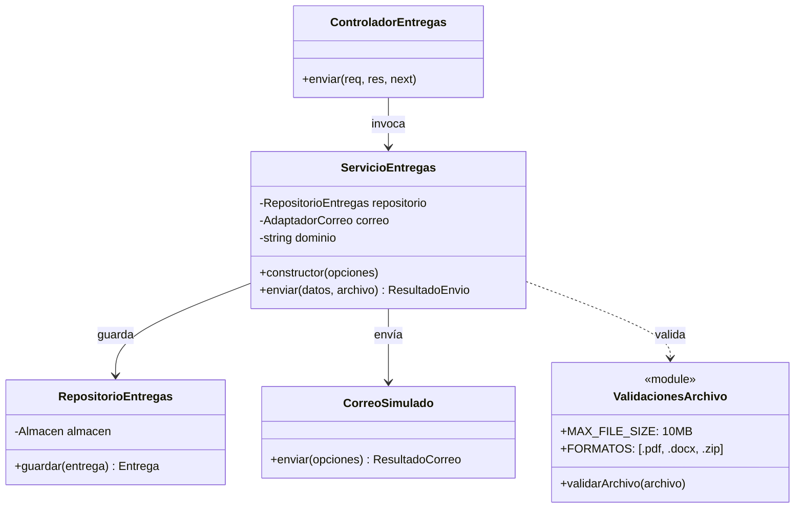

# Tarea 03: envío simulado de tareas por correo

Historia: **HU-03 — Envío de tareas por correo electrónico (US-01 en repositorio externo)**.

## Alcance del incremento

Implementar el flujo de entrega de tareas estudiantiles mediante correo institucional simulado:

- Remitente institucional validado bajo el dominio configurado (`@est.umss.edu.bo`).
- Destinatario con formato válido de correo de docente.
- Identificador o código formal de tarea (`taskCode`).
- Archivo adjunto obligatorio en formatos permitidos (`.pdf`, `.docx`, `.zip`) con tamaño máximo de 10 MB.
- Integración con el servicio de correo simulado (`correoSimulado`): si el correo confirma el envío, la entrega se persiste con fecha, hora y estado inicial `POR REVISAR`.
- Si el servicio de correo falla, no se confirma el envío ni se guarda la entrega en el repositorio.

La entrega se almacena en el repositorio unificado de memoria (`datos-memoria.js`) y cuenta con soporte relacional en `backend/database/schema.sql` (`entregas`).

---

## Pruebas de aceptación del incremento

| Caso | Dado / cuando | Resultado esperado |
| --- | --- | --- |
| Envío exitoso | Remitente institucional, adjunto válido (`.pdf`) y correo de docente | Se confirma envío simulado, estado `POR REVISAR` y entrega persistida |
| Sin archivo adjunto | Se intenta enviar sin adjuntar ningún archivo | Se rechaza con `Debe adjuntar un archivo` (HTTP 400) |
| Formato de archivo no permitido | Se adjunta un archivo con extensión no permitida (ej. `.exe`) | Se rechaza indicando formatos permitidos: `.pdf`, `.docx`, `.zip` |
| Tamaño de archivo excedido | Se adjunta un archivo que supera los 10 MB | Se rechaza indicando que no puede superar los 10 MB |
| Archivo vacío | Se envía un archivo con tamaño 0 bytes | Se rechaza con `El archivo está vacío` |
| Remitente no institucional | Correo del remitente fuera del dominio institucional (ej. `@gmail.com`) | Se rechaza indicando que debe usar el dominio `@est.umss.edu.bo` |
| Correo docente inválido | Destinatario con formato de correo sintácticamente inválido | Se rechaza con `Correo del docente inválido` |
| Código de tarea vacío | Se envía código de tarea vacío o con espacios | Se rechaza con error de validación de código de tarea |
| Fallo del servicio de correo | El servicio de correo simulado falla o rechaza el envío | Se lanza `AppError(502)` y la entrega NO se guarda en el repositorio |

---

## Diagrama UML del incremento



---

## Evidencia de Pruebas Unitarias Automatizadas

Las pruebas unitarias fueron diseñadas y ejecutadas con **Jest** (autor original de la suite: arubis, preservado en el historial de commits).

Se ejecutan con:
```bash
pnpm --prefix backend test -- src/modulos/entregas-tareas/
```

### Resultados de la suite de entregas (10 pruebas en verde)

| Archivo de Prueba | Caso de Prueba | Criterio Asociado | Resultado |
|---|---|---|---|
| `entregas.service.test.js` | Envío exitoso con remitente institucional, adjunto válido y correo docente | CA-01, CA-02, CA-06 | ✅ PASS |
| `entregas.service.test.js` | Sin adjunto: rechazo con "Debe adjuntar un archivo" | CA-03 | ✅ PASS |
| `entregas.service.test.js` | Formato inválido: rechazo de archivo `.exe` | CA-04 | ✅ PASS |
| `entregas.service.test.js` | Tamaño excedido: rechazo de archivo superior a 10 MB | CA-05 | ✅ PASS |
| `entregas.service.test.js` | Remitente fuera del dominio institucional | CA-01 | ✅ PASS |
| `entregas.service.test.js` | Correo del docente inválido | CA-02 | ✅ PASS |
| `entregas.service.test.js` | Fallo del servicio de correo: no confirma ni guarda entrega | CA-07 | ✅ PASS |
| `entregas.validaciones.test.js` | Rechazo cuando no se adjunta archivo | CA-03 | ✅ PASS |
| `entregas.validaciones.test.js` | Rechazo de extensión `.exe` | CA-04 | ✅ PASS |
| `entregas.validaciones.test.js` | Rechazo de archivo mayor a 10 MB | CA-05 | ✅ PASS |

---

## Operaciones y Reglas de Negocio Descubiertas

1. **Orden de Operaciones Crítico**: El adaptador de correo simulado debe ejecutarse **antes** de guardar en el repositorio. Si el correo falla o rechaza, la entrega nunca debe persistirse, evitando estados inconsistentes.
2. **Buffer del Archivo**: Para desacoplar el almacenamiento de archivos temporales en disco, el contenido del archivo se procesa en memoria (`Buffer.from(archivo.buffer)`) asociando nombre original y mimetype.
3. **Estado Inicial Determinístico**: Toda entrega confirmada nace obligatoriamente con estado `'POR REVISAR'` y `feedback: null`.
4. **Respuestas Informativas**: El endpoint responde con `{ id, estado: 'ENVIO_SIMULADO', enviado, mensaje }`, aclarando que ningún correo externo real fue emitido.

---

## Checklist XP de esta tarea

- [x] Alcance, reglas y criterios de aceptación identificados.
- [x] Diagrama UML y arquitectura de servicio elaborados.
- [x] Tarjetas CRC elaboradas y sincronizadas.
- [x] Pruebas unitarias de validación y de servicio diseñadas e implementadas.
- [x] 10 pruebas unitarias ejecutadas satisfactoriamente en verde (Jest).
- [x] Manejo de errores de validación HTTP 400 y de servicio externo HTTP 502.
- [x] Integración con el almacén unificado de datos (`datos-memoria.js`).
- [x] Controlador y ruta HTTP `POST /api/entregas` con middleware `multer` en memoria.
