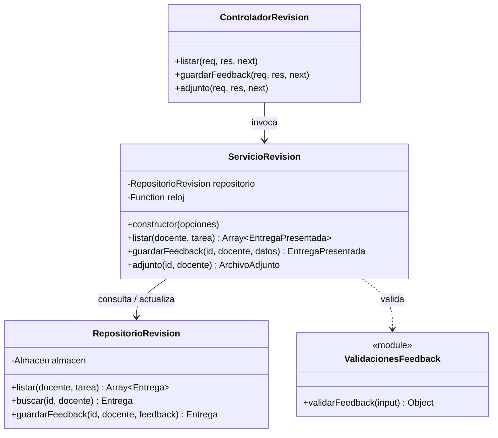

# Tarea 04: revisión de tareas con feedback estructurado

Historia: **HU-04 — Revisión de tareas con retroalimentación estructurada (US-02 en repositorio externo)**.

## Alcance del incremento

Implementar el módulo para que los docentes consulten entregas, descarguen archivos adjuntos y registren retroalimentación guiada:

- Consulta de entregas por correo del docente y código de tarea (`listar(docente, tarea)`).
- Desduplicación por estudiante: si un estudiante envió múltiples entregas para una misma tarea, el sistema selecciona automáticamente la más reciente según la fecha de recepción (`recibido`).
- Descarga segura del archivo adjunto asociado a una entrega (`adjunto(id, docente)`).
- Registro y actualización de feedback estructurado en tres aspectos obligatorios:
  - `correcto`: lo que está bien.
  - `incorrecto`: lo que está mal.
  - `corregir`: lo que debe corregir.
- Validación de contenido no vacío (rechaza cadenas con solo espacios) y límite de hasta 10,000 caracteres por campo.
- Transición de estado: al registrar el feedback, la entrega cambia de `'POR REVISAR'` a `'REVISADA'` conservando su marca temporal de actualización.

---

## Pruebas de aceptación del incremento

| Caso | Dado / cuando | Resultado esperado |
| --- | --- | --- |
| Consultar entregas recibidas | Existen entregas para el docente y tarea solicitados | Lista con estudiantes, fecha de recepción y estado inicial `POR REVISAR` |
| Sin entregas | No existen entregas para la combinación docente/tarea | Devuelve una lista vacía `[]` |
| Múltiples entregas de un estudiante | El estudiante realizó 2 o más entregas para la misma tarea | Solo se devuelve la entrega más reciente en base a la fecha `recibido` |
| Descargar archivo adjunto | Docente solicita el adjunto de una entrega válida | Devuelve el objeto de archivo con buffer binario y cabeceras de descarga |
| Registrar feedback completo | Se envían `correcto`, `incorrecto` y `corregir` con texto válido | Se guarda el feedback, se registra la marca temporal y el estado pasa a `REVISADA` |
| Campo de feedback faltante o vacío | Se omite o envía vacío alguno de los 3 campos obligatorios | Se rechaza indicando cuál campo falta (HTTP 400) |
| Campo con solo espacios | Se envía un campo de feedback compuesto únicamente de espacios | Se rechaza con error de validación de campo vacío (HTTP 400) |
| Longitud mayor a 10,000 caracteres | Se envía un campo que supera el límite de longitud | Se rechaza indicando que no puede superar 10000 caracteres |
| Entrega inexistente | Se intenta calificar una entrega inexistente o de otro docente | Se rechaza con `No existe entrega para revisar` (HTTP 404) |
| Actualizar feedback | Se envía nuevo feedback sobre una entrega previamente `REVISADA` | Se actualizan los 3 campos y la fecha, conservando el estado `REVISADA` |

---

## Diagrama UML del incremento



---

## Evidencia de Pruebas Unitarias Automatizadas

Las pruebas unitarias fueron diseñadas y ejecutadas con **Jest** (autor original: arubis).

Se ejecutan con:
```bash
pnpm --prefix backend test -- src/modulos/revision-tareas/
```

### Resultados de la suite de revisión (13 pruebas en verde)

| Archivo de Prueba | Caso de Prueba | Criterio Asociado | Resultado |
|---|---|---|---|
| `revision.service.test.js` | Ver entregas recibidas: lista de estudiantes con fecha y estado `POR REVISAR` | CA-01 | ✅ PASS |
| `revision.service.test.js` | Sin entregas: devuelve lista vacía | CA-01 | ✅ PASS |
| `revision.service.test.js` | Abrir la tarea: obtener y descargar archivo adjunto | CA-03 | ✅ PASS |
| `revision.service.test.js` | Feedback completo: guarda los 3 campos y estado pasa a `REVISADA` | CA-04, CA-06 | ✅ PASS |
| `revision.service.test.js` | Campo vacío: rechaza indicando cuál falta y no modifica la entrega | CA-05 | ✅ PASS |
| `revision.service.test.js` | Estudiante sin entrega: rechaza con "No existe entrega para revisar" | CA-01 | ✅ PASS |
| `revision.service.test.js` | Modificar feedback: actualiza contenido y conserva estado `REVISADA` | CA-07 | ✅ PASS |
| `revision.service.test.js` | Varios envíos del mismo estudiante: toma el más reciente | CA-02 | ✅ PASS |
| `revision.validaciones.test.js` | Feedback completo: 3 campos válidos aceptados | CA-04 | ✅ PASS |
| `revision.validaciones.test.js` | Campo vacío: falta "lo que está bien" | CA-05 | ✅ PASS |
| `revision.validaciones.test.js` | Campo vacío: falta "lo que está mal" | CA-05 | ✅ PASS |
| `revision.validaciones.test.js` | Campo vacío: falta "lo que debe corregir" | CA-05 | ✅ PASS |
| `revision.validaciones.test.js` | Campo con solo espacios rechazado | CA-05 | ✅ PASS |

---

## Operaciones y Reglas de Negocio Descubiertas

1. **Desduplicación en Memoria**: La lógica de `listar` agrupa por `entrega.estudiante.correo` usando un `Map`. Si se detecta un correo con fecha de recepción mayor, sobreescribe al anterior. Finalmente ordena descendentemente por fecha.
2. **Descarga con Sanitización de Nombres**: El controlador de adjuntos reemplaza caracteres de control en el nombre de archivo (`/[\r\n\/\\]/g`) y configura cabeceras `Content-Disposition` con codificación RFC-5987 (`UTF-8''...`) y `X-Content-Type-Options: nosniff`.
3. **Control de Acceso por Docente**: Todas las operaciones (`listar`, `buscar`, `guardarFeedback`, `adjunto`) verifican que el correo del docente coincida con el asignado a la entrega, impidiendo que docentes no asignados lean o alteren entregas ajenas.

---

## Checklist XP de esta tarea

- [x] Alcance, reglas y criterios de aceptación identificados.
- [x] Diagrama UML y flujo de revisión elaborados.
- [x] Tarjetas CRC elaboradas y sincronizadas.
- [x] Pruebas unitarias de validación y servicio diseñadas e implementadas.
- [x] 13 pruebas unitarias ejecutadas satisfactoriamente en verde (Jest).
- [x] Soporte para desduplicación de entregas por fecha más reciente.
- [x] Manejo de errores HTTP 400 (validación) y HTTP 404 (entrega no encontrada).
- [x] Endpoints HTTP `GET /api/revision/entregas`, `PUT /api/revision/entregas/:id/feedback` y `GET /api/revision/entregas/:id/adjunto`.
